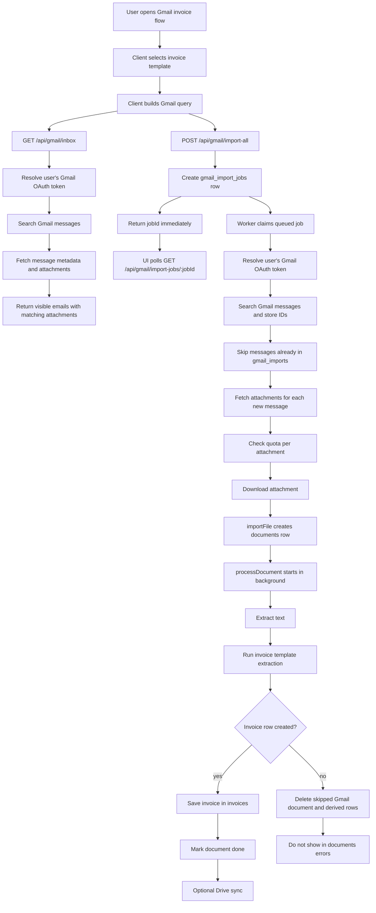
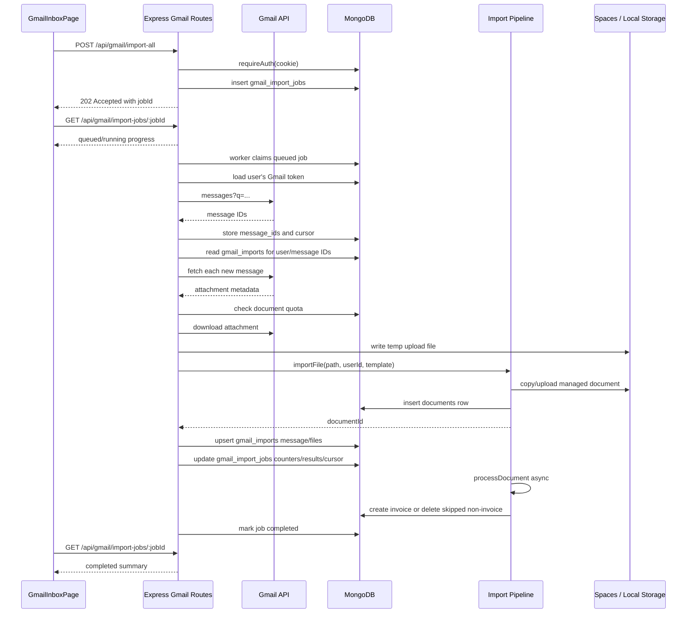
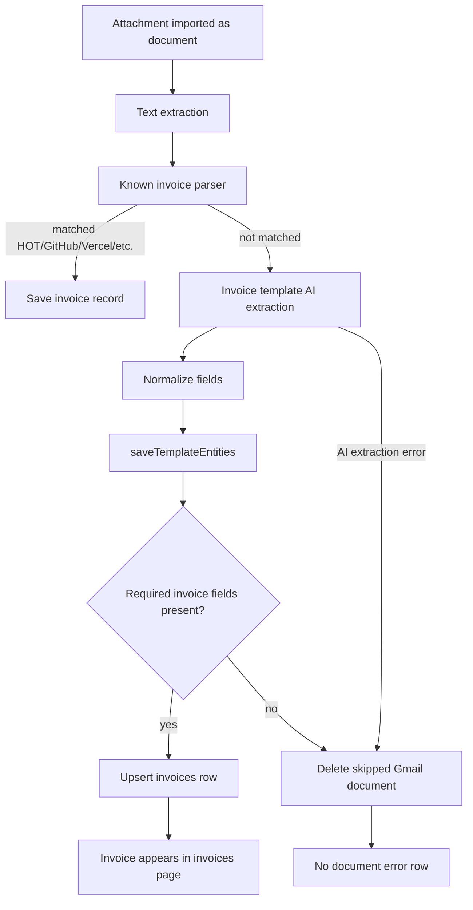
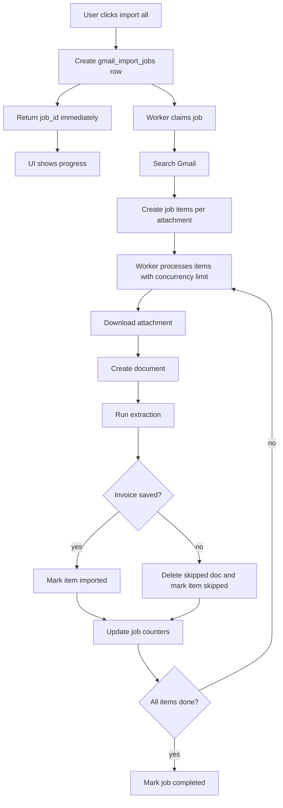

# Gmail Invoice Import Flow

This document describes how Gmail invoice import works today and how it behaves in production with multiple users.

## Executive Summary

Gmail invoice import is a durable background job flow:

1. The client builds a Gmail search query from the selected guided flow.
2. `POST /api/gmail/import-all` creates a `gmail_import_jobs` row and returns a `jobId`.
3. A background worker claims queued jobs and resolves the authenticated user's Gmail OAuth token.
4. The worker searches Gmail, stores message IDs, and imports message-by-message.
5. Each attachment is inserted into `documents`.
6. Document processing starts in the background inside the same Node process.
7. Invoice extraction creates rows in `invoices`.
8. Non-invoices in the invoice flow are skipped and deleted instead of being saved as document errors.
9. The UI polls `GET /api/gmail/import-jobs/:jobId` for progress and final results.

The job stores message IDs and a cursor, so stale `running` jobs can be re-queued and resumed after a restart or deploy.

## Current Invoice Query

For the invoice guided flow, the client enables:

- PDF
- DOC / DOCX
- XLS / XLSX
- No images

The query shape is:

```text
has:attachment {filename:pdf filename:doc filename:docx filename:xls filename:xlsx} {<invoice template keywords>}
```

The invoice template keywords are seeded from two sources:

- Base invoice words, such as `חשבונית`, `invoice`, `receipt`, `bill`, `חשבונית מס`, `קבלה`, `דרישת תשלום`, `פירוט חשבון`, `פירוט חודשי`, `לתשלום`, `תקופת חיוב`, `מספר לקוח`, and meter/account identifiers.
- Enabled Gmail search providers from `DEFAULT_GMAIL_SEARCH_PROVIDERS`, including each provider `label` and every configured search term/domain.

Images are intentionally excluded from invoice import by default because Gmail messages often contain inline logos and signatures named `image.png` or `image001.png`.

## Provider Tags and OCR Interaction

Provider tags are stored in MongoDB collection `gmail_search_providers` and are seeded by `seedGmailSearchProviders()` from `server/src/gmail/searchProviders.ts`.

They interact with the import flow in four places:

1. **Gmail discovery** — `/api/gmail/search-providers` feeds the sender/provider dropdown. When a provider is selected, the client builds a Gmail query using that provider's configured terms.
2. **Bulk import matching** — the invoice template's `match_keywords` include provider labels and terms, so import-all searches can find provider invoices even when the subject uses a brand name rather than the word `invoice`.
3. **Source/provider tagging** — when an attachment is imported, the server compares the email sender, subject, and filename against enabled providers. A match can populate source metadata such as business/provider hints.
4. **OCR/template classification** — providers do not run OCR and do not replace OCR. OCR still extracts text from the attachment. After text extraction, the provider keywords increase the chance that the invoice template matches documents containing names like `HOT`, `גולן טלקום`, `שופרסל`, `Pango`, or `כביש 6`.

Important distinction:

- Provider list = search terms, tags, and template matching hints.
- OCR = text extraction from PDF/image/DOCX content.
- Known invoice parsers = supplier-specific deterministic field extraction, such as the HOT parser.

Adding a provider helps Gmail find and classify the file, but it does not automatically guarantee full invoice field extraction. If a provider has unusual invoice layout, add a known parser or improve the generic invoice extraction prompts/field rules.

## Current Provider List

The source of truth is `DEFAULT_GMAIL_SEARCH_PROVIDERS`. The seeded DB collection is `gmail_search_providers`.

### Electricity

- חשמל - חברת חשמל לישראל
- חשמל - נגה / ניהול מערכת החשמל
- חשמל - אלקטרה פאוור
- חשמל - סלקום חשמל
- חשמל - פרטנר חשמל
- חשמל - בזק חשמל
- חשמל - HOT Energy
- חשמל - אמישראגז חשמל
- חשמל - פזגז חשמל

### Telecom

- תקשורת - בזק
- תקשורת - בזק בינלאומי
- תקשורת - פלאפון
- תקשורת - סלקום
- תקשורת - פרטנר
- תקשורת - HOT
- תקשורת - HOT Mobile
- תקשורת - 012 מובייל
- תקשורת - 013 נטוויז'ן
- תקשורת - 018 אקספון
- תקשורת - 019 טלזר
- תקשורת - גולן טלקום
- תקשורת - רמי לוי תקשורת
- תקשורת - Wecom
- תקשורת - אינטרנט רימון
- תקשורת - בינת עסקים
- תקשורת - Unlimited / IBC

### Water

- מים - מקורות
- מים - מי אביבים
- מים - הגיחון
- מים - מי שבע
- מים - מי ברק
- מים - מי רמת גן
- מים - מניב ראשון
- מים - מי ציונה
- מים - מי מודיעין
- מים - מי אונו
- מים - מי הרצליה
- מים - מי נתניה
- מים - מי רעננה
- מים - שרונים
- מים - עין אפק
- מים - מי כרמל
- מים - יובלים אשדוד
- מים - מי אשקלון
- מים - פלגי השרון
- מים - פלג הגליל
- מים - מעיינות השרון
- מים - מעיינות המשולש
- מים - מי עירון
- מים - התנור

### Transport and Parking

- תחבורה - כביש 6
- תחבורה - מנהרות הכרמל
- תחבורה - הנתיבים המהירים
- תחבורה - רכבת ישראל
- תחבורה - רב-קו אונליין
- תחבורה - רב-פס
- תחבורה - Moovit
- תחבורה - Gett
- תחבורה - Yango
- תחבורה - אגד
- תחבורה - דן
- תחבורה - מטרופולין
- תחבורה - קווים
- תחבורה - סופרבוס
- תחבורה - אלקטרה אפיקים
- תחבורה - תנופה
- תחבורה - נתיב אקספרס
- תחבורה - 6 צפון
- חניה - Pango
- חניה - Cello
- חניה - אחוזות החוף

### Fuel and Gas

- דלק - פז
- דלק - דלק
- דלק - סונול
- דלק - דור אלון
- דלק - Ten
- דלק - מנטה
- גז - אמישראגז
- גז - סופרגז
- גז - פזגז
- גז - דור גז

### TV, Streaming, and Marketplaces

- טלוויזיה - yes
- טלוויזיה - STINGTV
- טלוויזיה - HOT
- טלוויזיה - פרטנר TV
- טלוויזיה - סלקום TV
- טלוויזיה - FreeTV
- טלוויזיה - NEXT TV
- סטרימינג - Netflix
- סטרימינג - Amazon Prime Video
- סטרימינג - Disney+
- סטרימינג - Apple TV
- סטרימינג - Spotify
- קניות - Amazon
- קניות - AliExpress
- קניות - eBay
- קניות - KSP
- קניות - Ivory
- קניות - BUG
- קניות - Zap
- קניות - LastPrice
- קניות - TERMINAL X
- קניות - וואלה שופס

### Food

- מזון - שופרסל
- מזון - רמי לוי
- מזון - ויקטורי
- מזון - יוחננוף
- מזון - אושר עד
- מזון - טיב טעם
- מזון - קשת טעמים
- מזון - AM:PM
- מזון - Wolt
- מזון - תן ביס
- מזון - Cibus

### Payment and Invoice Platforms

- תשלומים - Grow
- תשלומים - Cardcom
- תשלומים - Tranzila
- חשבוניות - S-Invoice
- חשבוניות - MyOfficeGuy
- תשלומים - MoneySend
- דיגיטל - Morning (חשבונית ירוקה)

### Government and Municipal

- ממשלה - gov.il
- ממשלה - שירות התשלומים הממשלתי
- ממשלה - רשות המסים
- ממשלה - רשות שוק ההון
- ממשלה - משטרת ישראל
- דואר - דואר ישראל
- ממשלה - אתר האישורים צה"ל
- עירייה - תל אביב יפו
- עירייה - חולון

### Insurance and Finance

- ביטוח - הפניקס
- ביטוח - כלל
- ביטוח - מנורה מבטחים
- ביטוח - PassportCard
- ביטוח - שומרה
- ביטוח - Wobi
- ביטוח - מסלקה פנסיונית
- פיננסים - בנק לאומי
- פיננסים - בנק הפועלים
- פיננסים - IBI
- פיננסים - מור גמל ופנסיה

### Travel, Healthcare, Education, Retail, and Nonprofit

- תיירות - אל על
- תיירות - ישראייר
- תיירות - ארקיע
- תיירות - Ferryscanner
- תיירות - 12Go
- תיירות - Bravofly
- בריאות - הדסה
- בריאות - מכבידנט
- בריאות - FEMI
- בריאות - נטלי
- בריאות - מדיטון
- בריאות - Med Balance
- לימודים - HIT
- לימודים - ג'ון ברייס
- לימודים - Classoos
- לימודים - המכללה למנהל
- לימודים - Israel Cyber Campus
- לימודים - DevOps Experts
- לימודים - מיקה סנטר
- קמעונאות - מחסני חשמל
- קמעונאות - הום סנטר
- קמעונאות - אינטרטויס
- קמעונאות - A&A מחשבים וסלולר
- קמעונאות - שמרת הזורע
- קמעונאות - Fizikal
- קמעונאות - Headstart
- עמותות - הצופים
- עמותות - בני ברוך
- עמותות - שפרה פשוט לאהוב

### Digital and Development

- דיגיטל - Google
- דיגיטל - Slack
- דיגיטל - Notion
- דיגיטל - Figma
- דיגיטל - Canva
- דיגיטל - Linear
- דיגיטל - Atlassian
- פיתוח - OpenAI
- פיתוח - Anthropic
- פיתוח - GitHub
- פיתוח - GitLab
- פיתוח - npm
- פיתוח - Docker
- פיתוח - Vercel
- פיתוח - Netlify
- פיתוח - Render
- פיתוח - Railway
- פיתוח - DigitalOcean
- פיתוח - Cloudflare
- פיתוח - AWS
- פיתוח - Microsoft Azure
- פיתוח - Google Cloud
- פיתוח - Sentry
- פיתוח - Stripe
- פיתוח - Twilio
- פיתוח - SendGrid
- פיתוח - Resend
- פיתוח - Namecheap
- פיתוח - GoDaddy

## High-Level Flow



## Client Responsibilities

The Gmail page handles:

- Selecting the guided flow: invoice or inspection.
- Selecting the document template for extraction.
- Building the Gmail query from file-type toggles and template keywords.
- Calling `GET /api/gmail/inbox` for preview.
- Calling `POST /api/gmail/import-all` to create a bulk import job.
- Polling `GET /api/gmail/import-jobs/:jobId` until the job is completed or failed.
- Showing imported Gmail documents from `GET /api/gmail/import-history`.
- Deleting imported Gmail documents from the imported-documents table.

For the invoice flow, the important current defaults are:

```ts
{ pdf: true, doc: true, xls: true, img: false }
```

## Server Route Flow



## Important Collections

| Collection | Purpose |
|---|---|
| `users` | Stores Gmail OAuth tokens and usage counters. |
| `gmail_import_jobs` | Stores queued/running/completed bulk import jobs, message IDs, cursor, counters, and per-attachment results. |
| `gmail_imports` | Tracks imported Gmail messages/files per user, used to avoid duplicate imports. |
| `gmail_search_providers` | Stores enabled provider tags, search terms, categories, and sort order. Seeded from `DEFAULT_GMAIL_SEARCH_PROVIDERS`. |
| `documents` | Stores imported file metadata and processing status. |
| `extractions` | Stores OCR/AI extraction audit rows. |
| `invoices` | Stores normalized invoice rows shown in the invoices page. |
| `document_clients`, `contracts`, `reminders`, `tasks`, `equipment`, `timeline_events` | Derived records that may be created by generic document flows and must be cleaned for skipped Gmail invoice files. |

## Invoice vs Non-Invoice Handling

The invoice guided flow forces the invoice template. After extraction:



Required invoice fields currently include:

- supplier name
- invoice or receipt number
- client/company name
- issue date
- payment due date
- amount

If those are missing in the Gmail invoice flow, the document is treated as "not a usable invoice import" and is skipped/deleted.

## Multi-User Production Behavior

Every major query is scoped by `user_id`.

Examples:

- Gmail tokens are read from the authenticated user.
- `gmail_imports` uses `{ user_id, message_id }`.
- Documents are inserted with `user_id`.
- Invoices are queried with `user_id`.
- Imported Gmail history is filtered with `user_id`.
- Delete import-history uses `{ user_id, message_id }`.

This means two users can import from Gmail independently, even if they import messages with similar filenames or identical attachment hashes. Document deduplication is also scoped to the user by `{ user_id, file_hash }`.

The app also blocks connecting the same Gmail address to another user through `gmail_email` uniqueness checks, which helps prevent cross-account confusion.

## Current Weak Spots

### 1. Bulk import is synchronous at the HTTP route level

`POST /api/gmail/import-all` loops over Gmail messages and attachments inside one request. It downloads attachments and creates document rows serially.

Document processing itself starts asynchronously after `importFile`, but the import request still does a lot of work before responding.

Risk:

- Browser waits too long.
- Proxy/platform request timeout.
- User refresh creates confusing state.
- Node process restart can leave partial imports.
- Multiple users importing at once can compete for CPU, OCR, Gmail API, OpenAI, and storage bandwidth.

### 2. `gmail_imports` is message-level deduplication

If one attachment from a message fails or is skipped, the whole message can still be recorded. That keeps later `import-all` runs from revisiting that message unless the user deletes the import-history marker.

The new table delete action helps manually clear this, but background job design should make per-attachment state explicit.

### 3. Counters are lifetime counters

Usage counters intentionally do not decrement on ordinary deletes. That is good for quota enforcement, but recovery scripts are needed after bad imports.

### 4. Gmail diagnostics are passive

Logs say what happened, but the user does not get detailed reasons per skipped candidate yet.

## Do We Need a Queue?

Yes. For production, the bulk Gmail invoice import should use a queue.

The current flow is acceptable for small imports, but it is fragile for long operations. A queue would make the system safer and easier to operate with multiple users.

## Recommended Queue Design

Add import-job collections:

- `gmail_import_jobs`
- `gmail_import_job_items`

### `gmail_import_jobs`

Suggested fields:

```json
{
  "_id": "ObjectId",
  "user_id": "string",
  "template_id": "string",
  "flow": "invoice",
  "query": "string",
  "status": "queued | running | completed | failed | cancelled",
  "total_messages": 0,
  "total_attachments": 0,
  "imported": 0,
  "skipped": 0,
  "failed": 0,
  "created_at": "Date",
  "started_at": "Date",
  "finished_at": "Date",
  "error": "string | null"
}
```

### `gmail_import_job_items`

Suggested fields:

```json
{
  "_id": "ObjectId",
  "job_id": "ObjectId",
  "user_id": "string",
  "message_id": "string",
  "attachment_id": "string",
  "filename": "string",
  "mime_type": "string",
  "status": "queued | downloading | imported | skipped | failed",
  "document_id": "string | null",
  "invoice_id": "string | null",
  "skip_reason": "string | null",
  "error": "string | null",
  "attempts": 0,
  "created_at": "Date",
  "updated_at": "Date"
}
```

## Queue Flow



## Production Queue Rules

Recommended initial limits:

- One active Gmail import job per user.
- Global worker concurrency: 2-4 jobs.
- Per-user attachment concurrency: 1-2.
- Per-job max Gmail messages: keep 500 for now, later paginate.
- Per-item retry: 2 attempts for transient Gmail/storage/OpenAI errors.
- No retry for deterministic skip reasons like `non_invoice`.

This protects the app from one user consuming the whole worker capacity.

## API Shape With Queue

Recommended endpoint changes:

| Endpoint | Behavior |
|---|---|
| `POST /api/gmail/import-all` | Create job and return `{ jobId }` instead of doing all work inline. |
| `GET /api/gmail/import-jobs/:id` | Return progress, counters, current status, recent item errors. |
| `POST /api/gmail/import-jobs/:id/cancel` | Mark queued/running job as cancelled. |
| `GET /api/gmail/import-history` | Continue returning completed imported documents. |

The UI should poll `GET /api/gmail/import-jobs/:id` or subscribe by WebSocket/SSE.

## What Should Stay the Same

Even after adding a queue, keep these rules:

- User token resolution stays per authenticated user.
- All DB writes stay scoped by `user_id`.
- Invoice flow should skip non-invoices quietly.
- Documents page should not show Gmail invoice rejects as extraction errors.
- Gmail import history should stay clearable so users can re-import a message.
- Invoice import query should prefer document file types over images.

## Suggested Implementation Order

1. Keep current fixed direct import path for immediate production use.
2. Add job and job-item collections.
3. Change `POST /api/gmail/import-all` to enqueue a job.
4. Add a worker loop in the server process, or a separate worker process if deployment supports it.
5. Add UI progress polling.
6. Move `gmail_imports` updates from message-level completion to item-level completion.
7. Add admin visibility for stuck/failed jobs.

## Operational Notes

When diagnosing production imports, these log fields matter most:

- `gmail_import_all_query.query`
- `gmail_import_all_parse.requested_extensions`
- `gmail_import_all_parse.gmail_messages`
- `gmail_import_all_parse.visible_emails`
- `gmail_import_all_parse.matched_attachments`
- `gmail_import_all_parse.skipped_samples`
- `gmail_bulk_import.imported`
- `gmail_bulk_import.quota_limit_reached`
- `gmail_import_non_invoice_skipped`
- `gmail_import_invoice_extraction_failed_skipped`

For the corrected invoice flow, production logs should show requested extensions like:

```json
["pdf", "doc", "docx", "xls", "xlsx"]
```

If logs show `jpg`, `jpeg`, or `png` for invoice import, the deployed client is still using an old build or the user manually changed file type filters.
