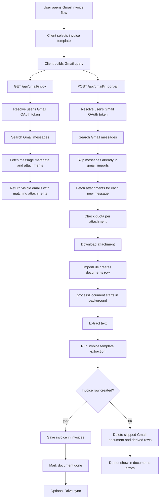
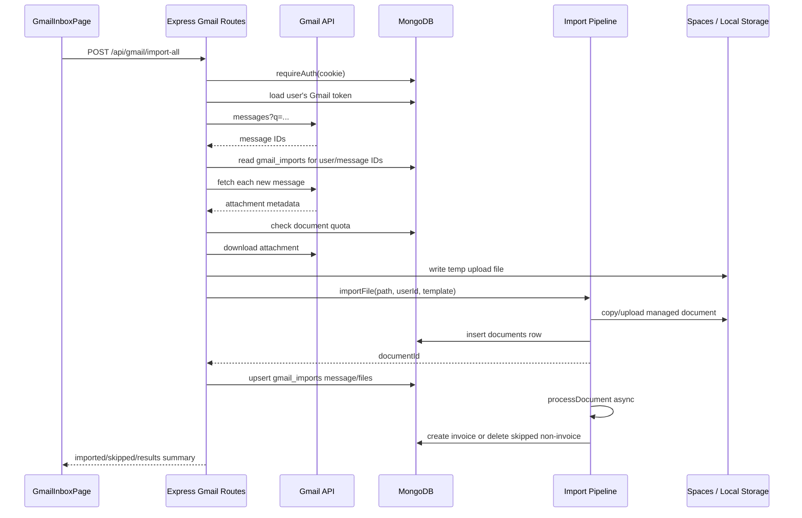
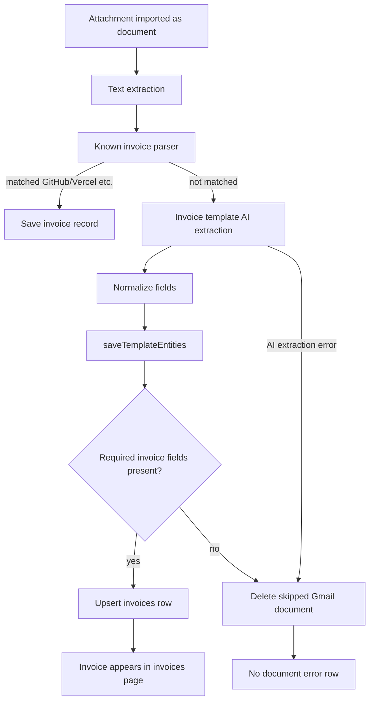
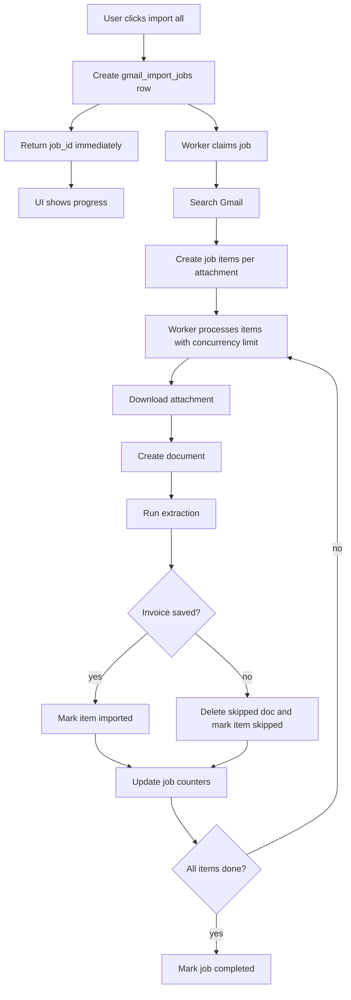

# Gmail Invoice Import Flow

This document describes how Gmail invoice import works today, how it behaves in production with multiple users, and what should change before the import volume grows.

## Executive Summary

Gmail invoice import is currently a request-driven flow:

1. The client builds a Gmail search query from the selected guided flow.
2. The server searches Gmail with the authenticated user's OAuth token.
3. The server downloads matching attachments.
4. Each attachment is inserted into `documents`.
5. Document processing starts in the background inside the same Node process.
6. Invoice extraction creates rows in `invoices`.
7. Non-invoices in the invoice flow are skipped and deleted instead of being saved as document errors.

This works for small and moderate batches, but `import-all` is not a durable background job. For production and multiple users, the Gmail bulk import path should move to a queue.

## Current Invoice Query

For the invoice guided flow, the client enables:

- PDF
- DOC / DOCX
- XLS / XLSX
- No images

The query shape is:

```text
has:attachment {filename:pdf filename:doc filename:docx filename:xls filename:xlsx} {"חשבונית" "invoice" "receipt" "GitHub" "Vercel" "חשבונית מס" "קבלה" "דרישת תשלום"}
```

Images are intentionally excluded from invoice import by default because Gmail messages often contain inline logos and signatures named `image.png` or `image001.png`.

## High-Level Flow



## Client Responsibilities

The Gmail page handles:

- Selecting the guided flow: invoice or inspection.
- Selecting the document template for extraction.
- Building the Gmail query from file-type toggles and template keywords.
- Calling `GET /api/gmail/inbox` for preview.
- Calling `POST /api/gmail/import-all` for bulk import.
- Showing imported Gmail documents from `GET /api/gmail/import-history`.
- Deleting imported Gmail documents from the imported-documents table.

For the invoice flow, the important current defaults are:

```ts
{ pdf: true, doc: true, xls: true, img: false }
```

## Server Route Flow



## Important Collections

| Collection | Purpose |
|---|---|
| `users` | Stores Gmail OAuth tokens and usage counters. |
| `gmail_imports` | Tracks imported Gmail messages/files per user, used to avoid duplicate imports. |
| `documents` | Stores imported file metadata and processing status. |
| `extractions` | Stores OCR/AI extraction audit rows. |
| `invoices` | Stores normalized invoice rows shown in the invoices page. |
| `document_clients`, `contracts`, `reminders`, `tasks`, `equipment`, `timeline_events` | Derived records that may be created by generic document flows and must be cleaned for skipped Gmail invoice files. |

## Invoice vs Non-Invoice Handling

The invoice guided flow forces the invoice template. After extraction:



Required invoice fields currently include:

- supplier name
- invoice or receipt number
- client/company name
- issue date
- payment due date
- amount

If those are missing in the Gmail invoice flow, the document is treated as "not a usable invoice import" and is skipped/deleted.

## Multi-User Production Behavior

Every major query is scoped by `user_id`.

Examples:

- Gmail tokens are read from the authenticated user.
- `gmail_imports` uses `{ user_id, message_id }`.
- Documents are inserted with `user_id`.
- Invoices are queried with `user_id`.
- Imported Gmail history is filtered with `user_id`.
- Delete import-history uses `{ user_id, message_id }`.

This means two users can import from Gmail independently, even if they import messages with similar filenames or identical attachment hashes. Document deduplication is also scoped to the user by `{ user_id, file_hash }`.

The app also blocks connecting the same Gmail address to another user through `gmail_email` uniqueness checks, which helps prevent cross-account confusion.

## Current Weak Spots

### 1. Bulk import is synchronous at the HTTP route level

`POST /api/gmail/import-all` loops over Gmail messages and attachments inside one request. It downloads attachments and creates document rows serially.

Document processing itself starts asynchronously after `importFile`, but the import request still does a lot of work before responding.

Risk:

- Browser waits too long.
- Proxy/platform request timeout.
- User refresh creates confusing state.
- Node process restart can leave partial imports.
- Multiple users importing at once can compete for CPU, OCR, Gmail API, OpenAI, and storage bandwidth.

### 2. `gmail_imports` is message-level deduplication

If one attachment from a message fails or is skipped, the whole message can still be recorded. That keeps later `import-all` runs from revisiting that message unless the user deletes the import-history marker.

The new table delete action helps manually clear this, but background job design should make per-attachment state explicit.

### 3. Counters are lifetime counters

Usage counters intentionally do not decrement on ordinary deletes. That is good for quota enforcement, but recovery scripts are needed after bad imports.

### 4. Gmail diagnostics are passive

Logs say what happened, but the user does not get detailed reasons per skipped candidate yet.

## Do We Need a Queue?

Yes. For production, the bulk Gmail invoice import should use a queue.

The current flow is acceptable for small imports, but it is fragile for long operations. A queue would make the system safer and easier to operate with multiple users.

## Recommended Queue Design

Add import-job collections:

- `gmail_import_jobs`
- `gmail_import_job_items`

### `gmail_import_jobs`

Suggested fields:

```json
{
  "_id": "ObjectId",
  "user_id": "string",
  "template_id": "string",
  "flow": "invoice",
  "query": "string",
  "status": "queued | running | completed | failed | cancelled",
  "total_messages": 0,
  "total_attachments": 0,
  "imported": 0,
  "skipped": 0,
  "failed": 0,
  "created_at": "Date",
  "started_at": "Date",
  "finished_at": "Date",
  "error": "string | null"
}
```

### `gmail_import_job_items`

Suggested fields:

```json
{
  "_id": "ObjectId",
  "job_id": "ObjectId",
  "user_id": "string",
  "message_id": "string",
  "attachment_id": "string",
  "filename": "string",
  "mime_type": "string",
  "status": "queued | downloading | imported | skipped | failed",
  "document_id": "string | null",
  "invoice_id": "string | null",
  "skip_reason": "string | null",
  "error": "string | null",
  "attempts": 0,
  "created_at": "Date",
  "updated_at": "Date"
}
```

## Queue Flow



## Production Queue Rules

Recommended initial limits:

- One active Gmail import job per user.
- Global worker concurrency: 2-4 jobs.
- Per-user attachment concurrency: 1-2.
- Per-job max Gmail messages: keep 500 for now, later paginate.
- Per-item retry: 2 attempts for transient Gmail/storage/OpenAI errors.
- No retry for deterministic skip reasons like `non_invoice`.

This protects the app from one user consuming the whole worker capacity.

## API Shape With Queue

Recommended endpoint changes:

| Endpoint | Behavior |
|---|---|
| `POST /api/gmail/import-all` | Create job and return `{ jobId }` instead of doing all work inline. |
| `GET /api/gmail/import-jobs/:id` | Return progress, counters, current status, recent item errors. |
| `POST /api/gmail/import-jobs/:id/cancel` | Mark queued/running job as cancelled. |
| `GET /api/gmail/import-history` | Continue returning completed imported documents. |

The UI should poll `GET /api/gmail/import-jobs/:id` or subscribe by WebSocket/SSE.

## What Should Stay the Same

Even after adding a queue, keep these rules:

- User token resolution stays per authenticated user.
- All DB writes stay scoped by `user_id`.
- Invoice flow should skip non-invoices quietly.
- Documents page should not show Gmail invoice rejects as extraction errors.
- Gmail import history should stay clearable so users can re-import a message.
- Invoice import query should prefer document file types over images.

## Suggested Implementation Order

1. Keep current fixed direct import path for immediate production use.
2. Add job and job-item collections.
3. Change `POST /api/gmail/import-all` to enqueue a job.
4. Add a worker loop in the server process, or a separate worker process if deployment supports it.
5. Add UI progress polling.
6. Move `gmail_imports` updates from message-level completion to item-level completion.
7. Add admin visibility for stuck/failed jobs.

## Operational Notes

When diagnosing production imports, these log fields matter most:

- `gmail_import_all_query.query`
- `gmail_import_all_parse.requested_extensions`
- `gmail_import_all_parse.gmail_messages`
- `gmail_import_all_parse.visible_emails`
- `gmail_import_all_parse.matched_attachments`
- `gmail_import_all_parse.skipped_samples`
- `gmail_bulk_import.imported`
- `gmail_bulk_import.quota_limit_reached`
- `gmail_import_non_invoice_skipped`
- `gmail_import_invoice_extraction_failed_skipped`

For the corrected invoice flow, production logs should show requested extensions like:

```json
["pdf", "doc", "docx", "xls", "xlsx"]
```

If logs show `jpg`, `jpeg`, or `png` for invoice import, the deployed client is still using an old build or the user manually changed file type filters.
