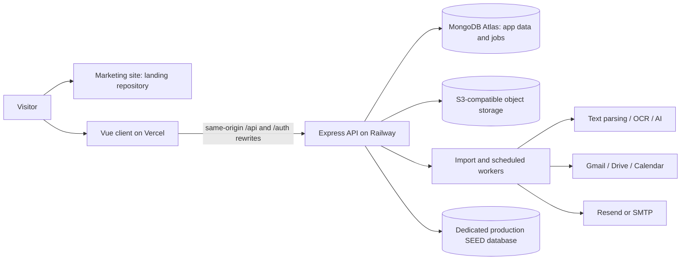
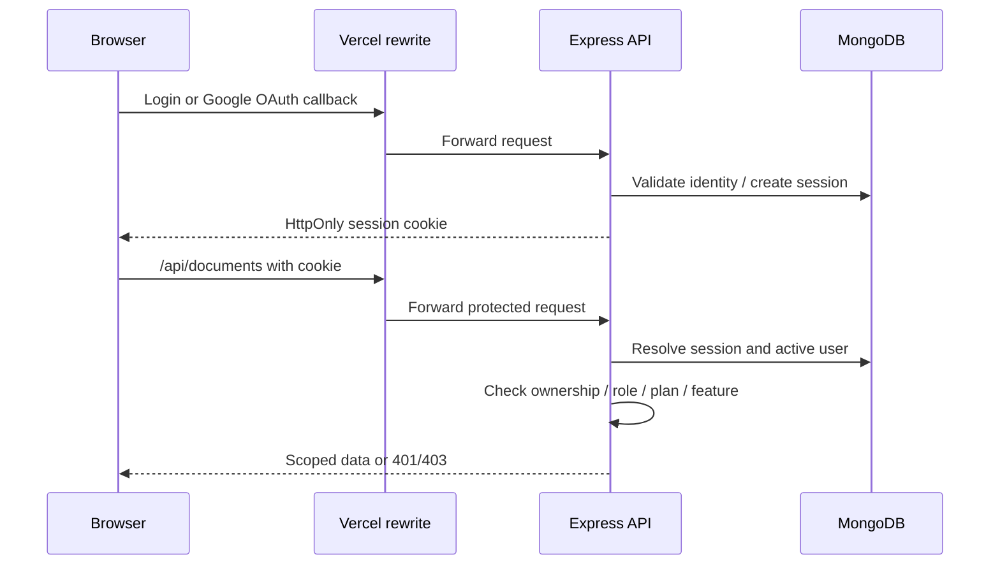
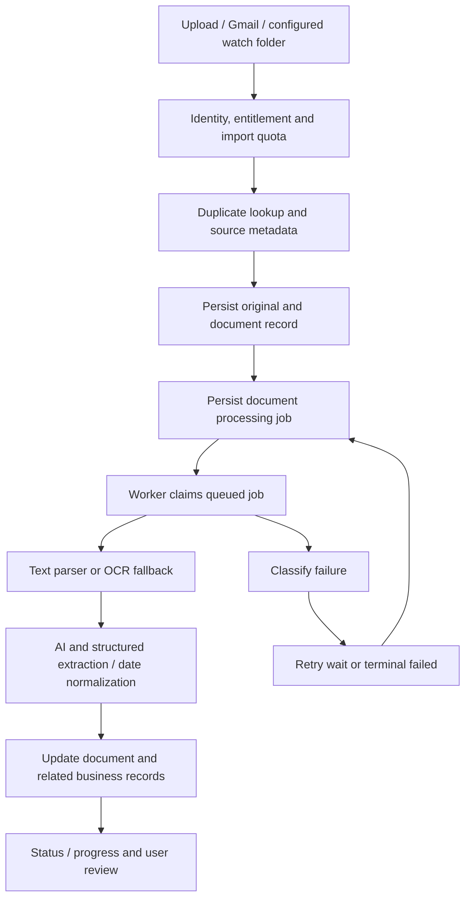

# RemindOCR production flow for developers

Code snapshot: 25 September 2026, based on `fc9ca7b` plus the English landing refresh. This guide describes the implemented flow and release checks. Hosted inventory was last checked during the 24 September environment investigation; it is not a fresh deployment certification. The earlier activation checklist in `deploy/DEVELOPMENT.md` is historical.

## 1. System boundaries and environments



| Surface | Production target | Hosted development target |
| --- | --- | --- |
| Marketing | `remindocr.com`, separate `reminder-landing` repo | Local landing preview |
| App | `app.remindocr.com`, Vercel branch `master` | `dev.remindocr.com`, branch `dev` |
| API | `api.remindocr.com`, Railway `production` / `reminder` | `api-dev.remindocr.com`, Railway `development` / `reminder-dev` |
| App database | Atlas Cluster10 / `reminder-app` | Atlas Cluster0-dev / `reminder-dev` |
| Runtime | `NODE_ENV=production`, `APP_ENV=production` | `NODE_ENV=production`, `APP_ENV=development` |
| SEED data | Dedicated production target | Same production SEED target, intentionally shared |

**Routing caveat at this snapshot:** `client/vercel.json` in both local branches points `/api/*` and `/auth/*` at `api-dev.remindocr.com`. This is not a production-safe default for the app deployment. Inspect the effective Vercel deployment configuration before releasing the app; production must route to the production API. A master branch name does not substitute environment destinations automatically. This documentation/landing change does not repair that pre-existing configuration.

The browser displaying `https://dev.remindocr.com/api/...` is expected with a rewrite: Vercel forwards the request server-side. It does not prove that the browser should call `api-dev` directly. Inspect effective rewrites and backend logs to establish the actual upstream.

## 2. Configuration and startup

Configuration is resolved in `server/src/settings.ts`; startup lives in `server/src/index.ts`. Supply secrets using platform environment settings, never checked-in files. `server/.env.example` is the variable reference.

1. Validate required environment: `MONGODB_URI`, `SESSION_SECRET`, `EMAIL_FROM`, `OPENAI_LOCAL_API_KEY`, and either Resend or SMTP credentials as enforced by `validateEnv`.
2. Connect MongoDB and initialize payment and WhatsApp queue collections.
3. Start the configured WhatsApp worker, initialize push, log OCR/PDF dependencies and seed built-in feature/document/email/print/Gmail-search definitions.
4. Run duplicate-generated-PDF reconciliation; start Gmail import, Drive export and document-processing workers, then the temporary-file sweeper.
5. Listen on the configured port (local default 3737). Start the reminder scheduler, unsubscribe scanner, metrics and optional watched-folder ingestion.
6. On SIGTERM/SIGINT, close the HTTP listener, stop temporary-file sweeping and the WhatsApp worker, and close database clients. Jobs interrupted during deployment must be checked for recovery; this is not a promise that every external side effect is exactly-once.

Use `/health` for process liveness and `/health/deps` for PDF/OCR dependency diagnostics. A green liveness response alone does not verify database access, authentication, email delivery or extraction. API documentation is exposed at `/api-docs`.

Configure `FRONTEND_URL`, `SERVER_URL`, Google redirect URLs, CORS origins and cookie settings coherently for each hostname. Hosted development still uses production Node behavior: `APP_ENV` controls application-environment behavior separately.

## 3. Request, identity and authorization flow



`server/src/auth/session.ts` creates opaque random session identifiers stored in MongoDB with a seven-day expiry. Cookie configuration includes HttpOnly, Path, Secure, SameSite and optional Domain. Google OAuth uses persisted state and PKCE. Email registration/login, verification, reset and magic-link paths are in the auth implementation.

`/api/auth/me` can return HTTP 200 with `user: null`; verify its JSON, not just its status. Protected endpoints return 401 for absent/invalid sessions and may return 403 for inactive users or authorization/plan restrictions. Admin impersonation and database selection require additional validation.

Known session caveat: the session parser takes the first cookie named `session`. A browser can send two cookies with that name when domain/path scopes overlap. During a 401 investigation, inspect cookie scopes and the selected database without logging cookie values. Clear obsolete scoped cookies and sign in again; a durable migration must deliberately expire old scopes or isolate environment cookie names. That migration is not implemented by this documentation release.

## 4. Database selection and ownership

`server/src/db/db.ts` provides local/production connection slots and request-local selection through AsyncLocalStorage. Slot labels are not reliable proof of the physical cluster. Hosted Node/Railway runtimes normally use their configured `MONGODB_URI`; `MONGODB_DB` selects the database. An explicitly configured secondary production URI enables the admin target and script overrides. `MONGODB_TARGET=production` only selects a configured production slot; it does not discover credentials or guarantee a particular host.

Resolve and verify the redacted host and database before migrations. Session identity must remain tied to its authentication database when an admin switches data targets. Application queries enforce ownership/roles in their route handlers; new endpoints need the same checks.

**SEED exception introduced in `fc9ca7b`:** `server/src/db/seedDb.ts` resolves `SEED_MONGODB_URI`, then `MONGODB_PRODUCTION_URI`, then the server database only when `APP_ENV=production`. Leads, campaigns, sends, unsubscribes and scan history use this dedicated production target in every environment. The admin Local/Production toggle does not isolate SEED. Missing configuration returns 503 rather than silently using a development copy. Treat outreach mutations from DEV as real production actions.

## 5. Document ingestion and processing



The principal implementation is `server/src/pipeline/importer.ts`, with file-type parsers, OCR, extractors and date normalization beside it. Browser intake lives in `routes/documents.ts`; Gmail has its own import job worker and passes documents through the shared pipeline. Duplicate files can be reused or requeued under the implemented recovery rules, rather than always creating a new record.

Document processing jobs use `queued`, `running`, `retry_wait`, `completed` and `failed` states. Due retries and stale running locks are recovered by the worker. Document processing status is separate from the job status. Diagnose both before replaying an import. Extracted results update related contracts/invoices/equipment where the processing path calls for them; not every document becomes all three.

Keep originals accessible while jobs need them. S3-compatible storage is implemented in `storage/spaces.ts`; local storage paths are fallback behavior, not a guarantee of durable files on an ephemeral host. Drive export uses its own queue and OAuth connection. The temporary sweeper defaults to six-hour retention and a 60-minute sweep; review the configuration before changing recovery retention.

AI/OCR output needs user review. For missing report categories, distinguish equipment category from machine description, trace the saved document/linked record/API projection/UI mapping, then run a targeted backfill. Do not infer a category solely from a filename or overwrite a reviewed value indiscriminately.

## 6. Gmail, Google services and notifications

Gmail: connect account through OAuth, select eligible history/search, create an import job, fetch supported content, enforce shared import allowances, enqueue document processing, and expose results/errors. Google token failures require reconnecting the correct account rather than disabling ownership checks.

Drive: eligible account plus configured OAuth/storage, queued export, result persistence, and retry/error review. Calendar: Business entitlement plus a connected account; synchronize relevant dates through the calendar integration and scheduler paths. Avoid replaying an external write without checking the existing linked result.

Email: `reminders/emailSender.ts` uses configured Resend or SMTP. Reminder templates, grouped emails and delivery status handling live under `server/src/reminders/`. Notifications have read/unread APIs; web push depends on configuration and browser permission. WhatsApp uses its own configured queue and provider; starting the server does not guarantee the integration is enabled or deliverable.

## 7. Reminder and scheduled-work lifecycle

1. A reviewed contract/record supplies the relevant date and reminder configuration.
2. `reminders/scheduler.ts` checks the application environment, process controls, due work and plan eligibility.
3. Resolve recipients/template, compose the message and invoke the configured delivery provider.
4. Persist reminder/delivery results and expose them through the app. Diagnose delivery-provider rejection separately from a successful scheduler tick.
5. Monthly reports, billing-related work and Calendar synchronization have their own scheduler branches.

The main scheduler runs only for `APP_ENV=production`. `REMINDER_ENABLED=false` gates reminder/escalation branches, not every scheduled activity. Do not use that variable as a global background-work kill switch. Gmail, Drive, document processing, WhatsApp and SEED unsubscribe scanning are separately started workers/services; inspect their controls independently. Watch-folder ingestion requires explicit enablement.

Default reminder advance days are `[30,14,3]` and the reminder check interval is one hour in settings, subject to saved configuration. Do not hardcode landing-page example schedules into operational assumptions.

## 8. Features, billing and reporting

Customer UI modules are declared in `client/src/shared/features.ts`; runtime permissions are in `server/src/plans/tierFeatures.ts`. Marketing prices come from `client/src/shared/pricingCatalog.json`. A visible navigation item does not prove that the backend permits the action.

Trial: 30 days / 20 imports total. Basic: 50 shared upload/Gmail imports per month. Business: unlimited catalog import allowance, extended history, Calendar and field work. Digital: manual inspection workflow without import/AI/storage entitlement. Expired accounts retain existing-data access while gated capabilities stop. Check actual runtime gates for each endpoint when changing plans.

Reports include Excel/monthly download and send routes, contract PDF reporting and invoice expense summaries. Print templates supply generated inspection reports. Payment-related collections and routes exist; do not infer a fully automated checkout from a plan change or catalog page. Confirm the configured payment workflow before a billing release.

## 9. Development and release procedure

From the relevant package directory:

```powershell
# Server: install from lockfile, typecheck, test
cd E:\Projects\Reminder\server
npm ci
npm run build
npm test

# Client: install and build
cd E:\Projects\Reminder\client
npm ci
npm run build

# Shared pricing consistency
cd E:\Projects\Reminder
node scripts/sync-pricing.mjs --check
```

Local client dev runs on port 4173 and proxies API/auth/WebSocket requests to 127.0.0.1:3737. Start the server with its package dev command. The root test command is not the backend test suite. Use focused browser verification for UI changes.

Release sequence:

1. Inspect status, branch, remote and diff in both root and `landing`. Exclude unrelated work and secrets. The landing directory is a Git submodule with its own remote and master branch.
2. Verify the effective app rewrites, Railway environment, Mongo target, cookie/OAuth scope and background-worker settings. Keep the SEED shared-production exception visible during DEV tests.
3. Run checks relevant to the change. For a landing-only change, validate links, desktop/mobile layout, console and pricing synchronization; backend tests are required for backend changes.
4. Commit and push the landing repo first. Commit its new gitlink plus intended root changes and push root master. Ensure the remote landing commit exists before publishing the root reference.
5. Inspect actual deployment status after the Git push. A successful push does not prove a successful deployment or that the app and marketing projects both rebuilt.
6. Smoke-test `/health`, dependencies, login with a fresh scoped session, authenticated `/api/auth/me` JSON and `/api/documents`, then one permitted import through completion and original-file access.
7. Verify reminder preview and an explicitly authorized test delivery, applicable exports and enabled Google integrations. Check logs and queues after the smoke test. Use test recipients; DEV SEED is not a sandbox.

For this landing refresh, `scripts/sync-pricing.mjs` skips the English index marked `data-pricing-summary`; full generated prices remain on the dedicated pricing page. Keep that marker and generator behavior aligned.

## 10. Recovery and incident triage

| Symptom | First evidence | Recovery direction |
| --- | --- | --- |
| Many 401s after login | `/auth/me` response body, cookie scopes, selected session DB, effective rewrite | Remove obsolete cookie scope; correct environment routing/configuration and reauthenticate |
| 403 on a feature | User active state, role, tier, feature gate | Correct entitlement or intended access; do not bypass ownership checks |
| Stuck import | Job state/lock/retry time, document status, original object, parser logs | Restore source/dependency; retry via supported path and confirm no duplicate linked records |
| OCR failure | `/health/deps`, parser selection, original file and extraction error | Repair dependency/input; retain original and rerun targeted document |
| Missing original | Stored object key, bucket/environment, local-path fallback | Restore correct object/access; do not delete metadata as a shortcut |
| No reminders | APP_ENV, process pause, REMINDER_ENABLED, due date, tier, recipient and provider status | Fix the failing stage; inspect previous sends before manual replay |
| Atlas pool exhaustion | Active replicas, pool settings, shutdown logs | Resolve leaked/overlapping clients; size pools against Atlas limits |
| SEED 503 or unexpected shared data | Resolved SEED target and configuration | Configure intended production SEED DB; never silently fall back to DEV |

For a backfill: take a restorable backup or before-image of affected fields; define target host/database and exact missing-field predicate; dry-run counts and sample IDs; apply narrow conditional updates in batches; compare matched/modified/unresolved counts; verify API and UI on representative records. Record the script, commit and outcome without credentials or private document content. Restore from before-images if required. Git rollback alone cannot undo data mutations or sent messages.

For a release rollback: select the known-good deployment/commit for the affected service, check schema compatibility, restore routing/configuration if it changed, then repeat authentication/import checks. Preserve incident logs and failed originals. Avoid blanket queue replay after email or external-storage side effects.

## 11. Implementation map

| Concern | Source |
| --- | --- |
| Bootstrap, middleware, health and workers | `server/src/index.ts` |
| Settings / required variables | `server/src/settings.ts`, `server/.env.example` |
| Sessions / authentication | `server/src/auth/`, `server/src/routes/auth.ts` |
| DB slots / SEED exception | `server/src/db/db.ts`, `server/src/db/seedDb.ts` |
| Intake / extraction / jobs | `server/src/routes/documents.ts`, `server/src/pipeline/` |
| Gmail / Drive / Calendar | `server/src/routes/gmail.ts`, `gdrive.ts`, `calendar.ts`, `server/src/storage/` |
| Reminders and email delivery | `server/src/reminders/` |
| Business records | `server/src/routes/contracts.ts`, `clients.ts`, `equipment.ts`, `invoices.ts` |
| Reports and print | `server/src/routes/reports.ts`, `printTemplates.ts` |
| Feature / plan / price definitions | `client/src/shared/features.ts`, `server/src/plans/tierFeatures.ts`, `client/src/shared/pricingCatalog.json` |
| Frontend networking / deployment | `client/src/services/`, `client/vite.config.ts`, `client/vercel.json` |
| Separate marketing deployment | `.gitmodules`, `landing/`, `scripts/sync-pricing.mjs` |

Update this document when routing, DB selection, worker ownership, pricing gates or storage behavior changes. Platform settings remain the deployment source of truth and must be checked at release time.
